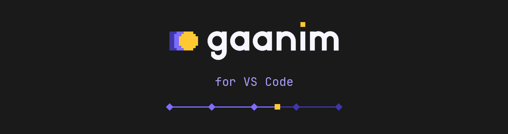

# Gaanim for VS Code

Write [Gaanim](https://paololupo.github.io/gaanim/) videos and slides in VS
Code. The extension drives the `gaanim` command: it creates projects, keeps
the live preview on the line you are editing, puts problems on their lines,
exports, presents, and keeps the narration script beside the code. It brings
everything [gaanim.nvim](https://github.com/PaoloLupo/gaanim.nvim) does to VS
Code, and uses Gaanim 0.13's editor channel (`--listen`), JSON messages and
`gaanim inspect`.

| Command | What it does |
|---|---|
| **Gaanim: New Project…** | `gaanim init` a slides or video project and open it |
| **Gaanim: Preview at Cursor** | the preview rests at the instant of the cursor's line, without a restart |
| **Gaanim: Toggle Preview Follows Cursor** | the preview follows the cursor through the code |
| **Gaanim: Toggle Live Mode** | saves as you type, so every change reaches the preview |
| **Gaanim: Toggle Loop of the Slide at Cursor** | plays the slide over and over, across reloads |
| **Gaanim: Open Narration Script Beside** | `narration/script.md` beside the code, on the slide you are on |
| **Gaanim: Export Still at Cursor** | a PNG of the cursor's instant, opened beside the code |
| **Gaanim: Export the Slide at Cursor…** | any preset limited to the slide under the cursor |
| **Gaanim: Present…** | from the start or the cursor, with a countdown and a monitor |

## What it does

- **Times in the code.** The time of each `play`, `stop`, segment, marker
  and voiceover at the end of its line (`▤ 0:00.0–0:01.0 · 1.0s`,
  `⏸ 0:01.3`), from the timeline Gaanim reports. An open preview sends it
  with every reload, so nothing runs twice; without one, `gaanim inspect`
  runs after a save. The status bar shows the cursor's instant.
- **Lenses over each slide**: `▶ Preview`, `⟲ Loop` (or `Unloop` while it
  loops), `Still`, how long its script takes to say against its `target=`
  (`≈0:42 / 1:00`, or *Write script*) and its time range; over each
  voiceover, whether its take is recorded and how long it is.
- **Hovers**: what a line makes on the timeline; the size, pixels or length
  of an asset file; where a `vo.wait_until("word")` lands in its take.
- **Code actions**: write a slide's missing script, name an unnamed stop, add
  a marker, preview the line, export its frame or its slide as a draft.
- **Outline and breadcrumbs**: slides with their stops, markers and
  voiceovers as document symbols. *Next/Previous Slide* and *Stop* move the
  cursor between them; *Go to Slide, Stop or Marker…* and *Go to Timeline
  Entry…* jump across the project and move the preview there.
- **Completion** of asset names inside `media.image("…")`, `svg`, `audio`,
  `video`… and of Typst math inside `equation(...)` strings and `$…$`: every
  codex 0.3.0 symbol with the character it draws (`α alpha`,
  `⇒ arrow.r.double`, `.` for variants), math functions as snippets,
  accents, operators and spaces.
- **Problems on their lines.** Saving runs `gaanim check` in the background;
  a failed reload puts the Python error on its line. Asset names that resolve
  to no file get a warning.
- **The preview, driven from the code.** Where the preview rests is marked in
  the code; while it plays, the lines whose `play` animates are highlighted.
  Gaanim's own *Open in the editor* (inspector, console, animation timeline,
  error panel, *Open and complete*) opens the line in this window.
- **Narration script.** The script beside the code follows the slide under
  the cursor, or the slide the preview shows while you present. *Go Between
  Slide and Its Script* jumps both ways and adds a missing section with a
  `[stop]` mark per stop. Each section shows how long it takes to say against
  its slide's `target=` (green, amber, red), and the title the whole talk
  against `scene.slides.target()`.
- **Exports** with a cancellable progress bar in percent: MP4, draft,
  production, WebM, MOV, GIF, WebP, PDF, PDF with notes, `.gaanim` bundle, a
  bundle made lighter for the web (`gaanim pack --web`), and stills.
- **Nudging numbers** (`Ctrl+Alt+A` / `Ctrl+Alt+X`): `0.8` → `0.9`,
  `0.25` → `0.26`; with live mode each nudge shows in the preview.
- **Docs of the installed Gaanim**: *Search Documentation…* and *Open API
  Entry at Cursor* read the docs bundled with the project's `.venv`, so they
  match its version.
- **Python completion**: points the Python extension at the project's
  `.venv`, where `gaanim init` installed the authoring package and its stubs.
- **Snippets**: `gslides`, `gvideo`, `gseg`, `gstop`, `gplay`, `gvo`,
  `gmark`, `gwait` in Python; `gsec`, `gstop`, `gnote` in Markdown.
- **Check Setup** reports `gaanim` and what it supports, FFmpeg, uv, the
  Python extension, the project's `.venv`, docs and script.

### Beyond gaanim.nvim

- **Gaanim side bar**: the project's real timeline as a tree (times,
  stops, markers, voiceovers; click to go there and move the preview, with
  Preview, Loop, Still, Export and Script on each entry), and your projects.
- **Preview Timeline panel**: the scene to scale (slides, stops, markers,
  voiceovers, the loop and the playhead) with play, loop, follow, live and
  still buttons. Click to move the preview, Alt+click to loop a slide,
  double-click to open its code.
- **Take inspector**: each `vo.wait_until("…")` and `vo.until("…")` is
  resolved the way Gaanim does (tapped mark, transcript, proportional place in
  the script); a word that lands nowhere gets a warning, and one that falls
  back to the script's proportion an information.
- **Script to code**: *Add the Script's Missing Slides to the Code* writes the
  `segment` (slides) or `voiceover` (video) calls that the script's `##`
  sections ask for, with a stop per `[stop]` mark.
- **Present…** asks where to start, how long the talk lasts and which
  monitor to use; stills open beside the code.
- File paths reach the preview the way Python spells them, so following the
  cursor works on Windows whatever the drive letter's case.

## Requirements

- VS Code 1.90 or newer (or Cursor, VSCodium).
- `gaanim` on `PATH`, or `gaanim.path` set. Gaanim 0.13 has everything; older
  versions work with less (see below).
- The Python extension (with Pylance or basedpyright) for completion of the
  Gaanim API.

The extension reads `gaanim --help` once and uses what the installed version
offers. Driving the preview (*Preview at Cursor* without a restart, *Follow*,
*Loop*, *Move Preview To…*, the playhead) needs `--listen`; exact problem
lines and export percent need `--message-format json`; times in the code and
the timeline need `inspect`; stills and ranges by slide name need `export` to
take names. Without them *Preview at Cursor* restarts the preview from the
cursor's slide and the rest reads the CLI's text.

## Keys

All under `Ctrl+Alt+G` (`Cmd+Alt+G` on macOS), in a Gaanim project:

| Then | Command | Then | Command |
|---|---|---|---|
| `P` | Preview at Cursor | `I` | Export Still at Cursor |
| `F` | Follow the cursor | `E` | Export… |
| `L` | Live mode | `C` | Check Project |
| `R` | Loop the slide | `T` | Narration script |
| `Space` | Play or pause | `G` | Slide ↔ script |
| `S` | Timeline entries | `K` | API entry at cursor |
| `Shift+P` | Present… | `Q` | Close preview |
| `↓` / `↑` | Next / previous slide | | |

## Settings

| Setting | Default | |
|---|---|---|
| `gaanim.path` | `gaanim` | the executable |
| `gaanim.projectsDir` | | where new projects go and the Projects view looks |
| `gaanim.preview.listen` | `true` | drive the preview with `--listen stdio` |
| `gaanim.preview.editor` | `true` | Gaanim's *Open in the editor* opens lines here |
| `gaanim.preview.followDelay` | `120` | ms the cursor settles before a following preview moves |
| `gaanim.present.duration` | | planned length (`20m`) |
| `gaanim.check.onSave` | `true` | check after saving |
| `gaanim.export.open` | `stills` | open stills beside the code, offer the rest |
| `gaanim.export.presets` | | extra or changed presets |
| `gaanim.script.wpm` | `150` | words per minute for spoken time |
| `gaanim.outline.patterns` | | teach the outline a project's own way of naming slides |
| `gaanim.live.delay` | `700` | ms after the last change before live mode saves |
| `gaanim.python.useProjectEnvironment` | `ask` | point the Python extension at the `.venv` |

`gaanim.outline.patterns` covers decks with one module per slide, such as
`NAME = "Cover"` in each:

```json
"gaanim.outline.patterns": [{ "kind": "segment", "pattern": "\\nNAME\\s*=\\s*\"([^\"]+)\"" }]
```

The timeline view needs none of this: it lists what the scene really made.

## Develop

```
npm install
npm run build          # dist/extension.js
npm test               # unit tests of the parsers, without VS Code
npm run package        # gaanim-<version>.vsix
```

`npm run test:integration` runs `test/integration/suite.ts` inside VS Code
against a stand-in `gaanim`; with `GAANIM_TEST_BIN` (a real `gaanim`) and
`GAANIM_TEST_PROJECT` (a project from `gaanim init`) it drives the real one,
whose preview needs a display and a GPU (Xvfb and Mesa's lavapipe work).
`scripts/gen_typst_symbols.py` regenerates the Typst symbol table from codex.
